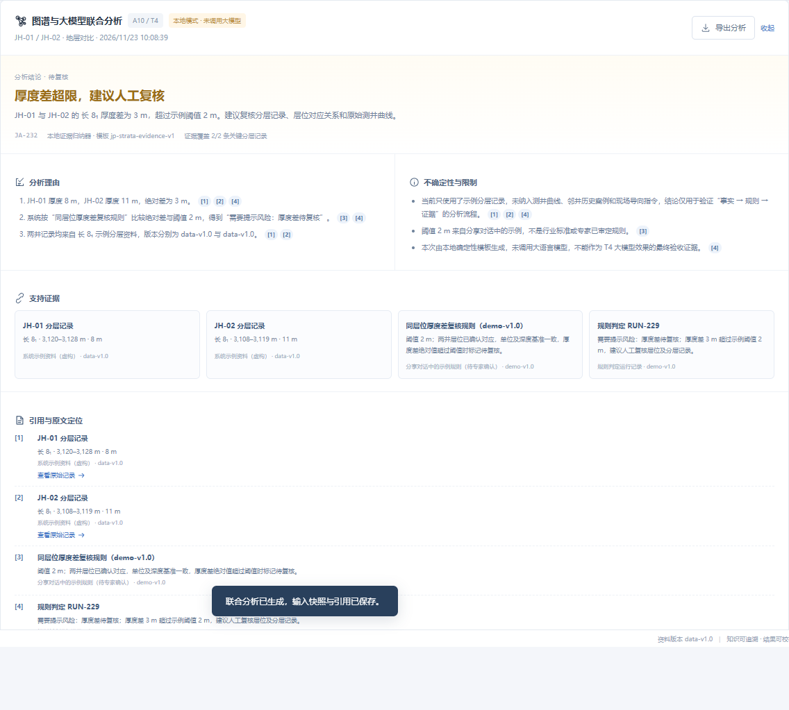
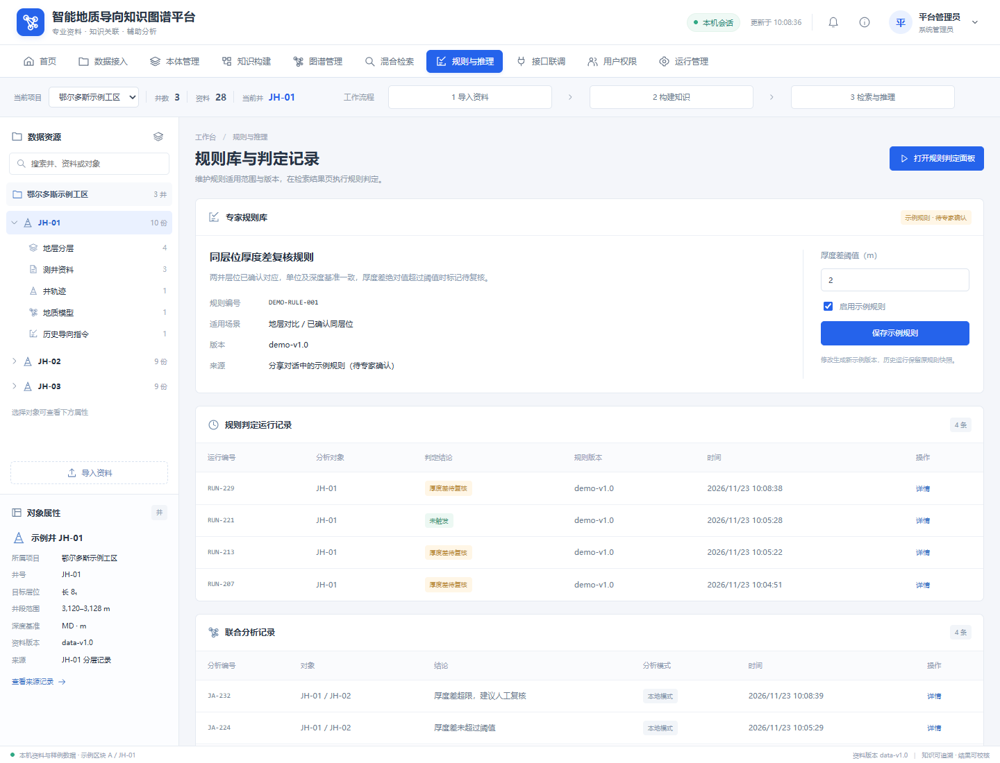

# 07 图谱与大模型联合分析（A10 / T4，地层对比场景）

版本：0.6.0。依据 `docs/页面搭建步骤.html` 第八步 M7-F8 与第九步的联合分析入口，先完成规则判定之后的地层对比联合分析流程。入口在“混合检索”页规则判定面板下方。

## 功能对应

| 编号 | 已实现行为 |
| --- | --- |
| M7-F8 | 单独触发联合分析，将规则判定结果、已授权图谱事实和分层证据整理为结构化结果；输出结论、理由、支持／反对证据、不确定性、引用、证据覆盖、分析模式和输入快照。 |
| A10 / T4 | 记录模型／模板版本与分析模式；当前未接入外部大模型时明确标注“本地模式 · 未调用大模型”，不把模板结果冒充为模型输出。 |
| M6-F3 | 联合分析的每条事实与规则均有引用编号；目标井／参考井引用可回到分层原始记录，规则与运行记录保留版本。 |
| M6-F4 | 分析上下文只使用当前用户可访问且字段未被隐藏的井、分层资料与规则；撤销权限后记录不可回看或导出。 |

## 使用流程

1. 启动 `npm start`，登录后进入“混合检索”。
2. 选择目标井、参考井和“地层对比”，选择样例并点击“运行规则判定”。
3. 规则判定成功后，点击“生成联合分析”。结果区展开在按钮下方，包括：
   - 分析结论与结论状态；
   - 分析理由，每条带引用编号；
   - 不确定性与限制；
   - 支持证据和反对／限制证据；
   - 引用与原文定位；
   - 本地模式声明和输入快照。
4. 点击“导出分析”下载 JSON；点击“收起”回到未生成状态。修改输入后旧结果失效，必须重新运行规则判定。
5. 在“规则与推理”页的“联合分析记录”中回看历史结果与详情。

## 结论状态

联合分析不重新计算规则，只解释规则结果。当前支持：

- `triggered`：厚度差超过阈值，建议人工复核；
- `not_triggered`：未超过阈值，同时提示仍可能存在分层误差；
- `insufficient`：资料不足，不把缺失值当作未触发；
- `no_rule`：无适用规则，不形成业务判断；
- `conflict`：规则冲突，转人工裁决。

邻井推荐场景已在 0.7.0 接入独立候选筛选、邻井可参考性规则和联合分析，详见《08邻井推荐场景实现说明》。

## 数据与权限边界

- 业务动作复用 `run` 与 `export` 权限；不新增独立权限项。
- 创建时重新核对规则判定记录归属、目标／参考井、分层对象和来源资料授权。
- 只向分析快照传递已解除字段限制的井字段；隐藏的 `distance` 等字段不会出现在快照中。
- 记录按用户、项目、井和当前实时授权过滤；证据或字段权限撤销后，历史联合分析不再返回，导出也会被拒绝。
- 审计记录“生成联合分析”和“导出联合分析”，包含分析编号与规则运行编号。
- 持久化位置为 `.runtime/platform.json` 的 `jointRuns`，离线模式保存到浏览器存储。

## 分析模式

当前默认分析器为 `local-evidence-v1`，模型标识 `deterministic-template`，模板版本 `jp-strata-evidence-v1`。0.8.0 另提供 `demo-llm-v1` 大模型示例模式，详见《09大模型联合分析示例模式实现说明》。它只根据规则结果和授权证据生成可复核文本，不调用网络或外部模型；结果中明确写出“不能作为 T4 大模型效果的最终验收证据”。

后续接入外部大模型时，应保留同一输入包和结果结构，并增加模型名称、提供方、调用时间、提示模板版本、超时和失败回退记录；不得把本地模板结果标记为模型结果。

## 接口

| 方法 | 路径 | 用途 |
| --- | --- | --- |
| POST | `/api/business/joint-run` | `projectId/wellId/runId`，基于当前规则判定生成并保存联合分析。 |
| POST | `/api/business/joint-export` | `projectId/wellId/analysisId`，重新检查导出权限并返回完整记录。 |
| GET | `/api/workspace` | 返回当前用户可见的 `jointRuns` 与 `jointProvider` 状态。 |

## 验证

`npm test` 当前共 114 项通过。`tests/joint.test.mjs` 覆盖：

- 超限、未触发、资料不足、无适用规则和规则冲突的不同结论；
- 引用编号均能对应实际证据，理由不引用不存在的来源；
- 结果固定输入与规则快照，不被后续对象修改污染；
- 未知场景明确返回未开放，不伪造结论；
- 用户隔离、隐藏字段不进入快照、撤销权限后不可回看或导出；
- HTTP 生成、工作区返回与导出闭环；
- 离线预览生成联合分析并与本机服务使用同一结果结构。