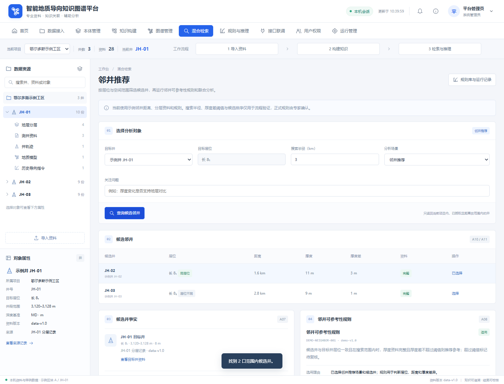
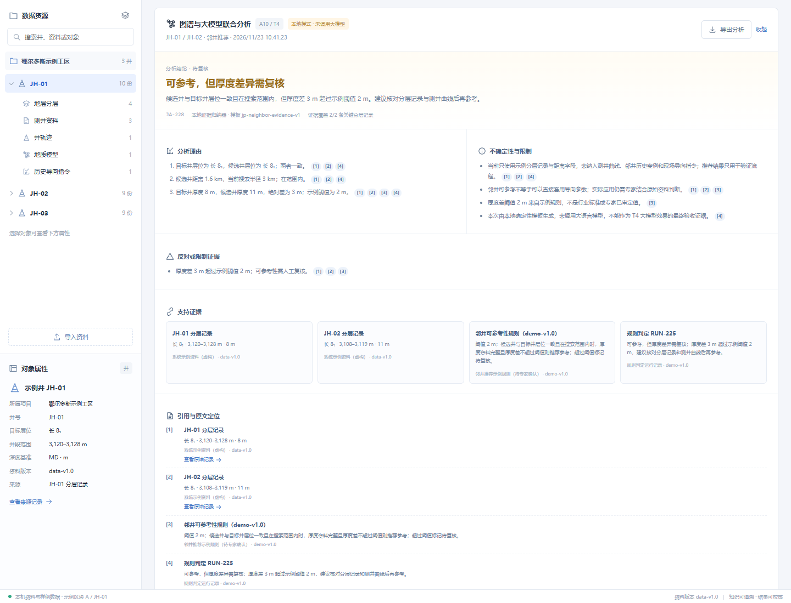
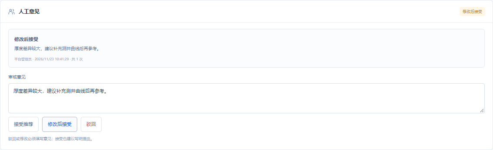
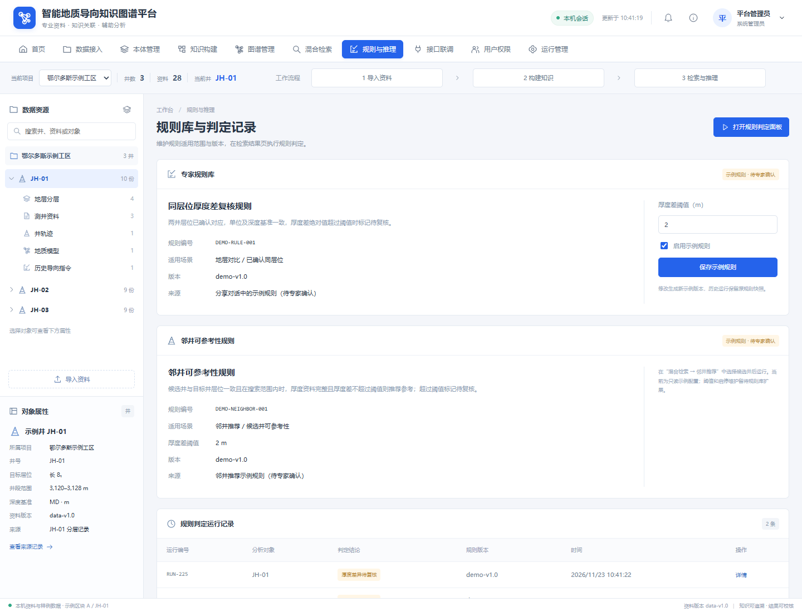

# 08 邻井推荐场景（A11 / T4）

版本：0.7.0。依据 `docs/页面搭建步骤.html` 第九步 9.1 邻井推荐结果区实现。入口在“混合检索”页的分析场景中选择“邻井推荐”。

## 功能对应

| 编号 | 已实现行为 |
| --- | --- |
| A11 / T4 | 先按目标井、层位、搜索半径和关注问题筛选候选邻井，再运行邻井可参考性规则，最后由联合分析解释推荐理由和不确定性。 |
| M7-F8 | 联合分析使用候选井事实、规则判定和引用，输出结论、理由、支持／反对证据、不确定性、证据覆盖和输入快照。 |
| M6-F4 | 候选井只来自当前项目内、当前用户有井／资料／字段授权的对象；超范围、跨项目和字段受限的井不会进入候选。 |
| T4 人工环节 | 有校核权限的专家可登记接受、修改后接受或驳回意见，记录审核人、时间和备注。 |

## 使用流程

1. 进入“混合检索”，把分析场景切换为“邻井推荐”。
2. 选择目标井、搜索半径，填写关注问题，点击“查询候选邻井”。
3. 候选表展示候选井、层位、距离、厚度、厚度差、资料完整度和选择按钮；默认选中排序第一的候选井。
4. 点击“运行邻井判定”，查看 A08 规则和 A09 逐项条件结果。
5. 点击“生成联合分析”，查看推荐理由、距离、厚度差异、证据和不确定性。
6. 有 `review` 权限的专家填写人工意见并选择接受、修改后接受或驳回。
7. 在“规则与推理”页的“联合分析记录”中回看历史结果与人工意见；点击“详情”后可选择“在检索页打开”，恢复候选井、规则判定、联合分析和人工意见上下文。

## 邻井可参考性规则

示例规则编号 `DEMO-NEIGHBOR-001`，版本 `demo-v1.0`，来源标注为“邻井推荐示例规则（待专家确认）”。

判定条件：

1. 候选井与目标井层位一致；
2. 候选井距离不超过当前搜索半径；
3. 两井厚度有效且大于零；
4. 厚度差不超过示例阈值 2 m。

结果状态：

- `recommended`：可作为参考邻井；
- `review`：可参考，但厚度差异需复核；
- `not_recommended`：层位不一致或超出搜索范围；
- `insufficient`：厚度等关键资料不足；
- `no_rule`：规则停用或场景不适用；
- `error`：规则阈值配置无效。

## 人工意见

有校核权限的用户可在联合分析下方登记：

- 接受推荐；
- 修改后接受；
- 驳回。

驳回或修改必须填写审核意见；接受也建议写明理由。每次审核追加到 `reviews`，最新一条同时保存在 `review`，并写入审计记录。专家可查看同项目、同井范围内由其他用户生成的邻井联合分析；普通工程师只能审核自己创建的记录，且没有 `review` 权限时不能提交意见。

## 数据与权限边界

- 查询候选井、运行邻井判定、生成联合分析和人工审核分别复用 `run` / `review` 权限。
- 候选井必须属于当前项目且有井访问权限；层位、井段、厚度、距离和来源字段受限时，该井不会进入候选。
- 距离直接使用当前示例井数据中的 `distance` 字段，不从井斜或坐标猜测；正式接入时应由空间索引或明确来源计算。
- 当前候选没有接入已发布历史案例，界面和联合分析都明确写出“未纳入邻井历史案例”，不虚构案例证据。
- 联合分析默认使用本地证据归纳模式；也可切换“大模型示例”生成截图型模型报告。示例模式用于展示报告结构和结构化依据，后续接入真实模型时可复用同一输入包和结果结构。

## 接口

| 方法 | 路径 | 用途 |
| --- | --- | --- |
| POST | `/api/business/neighbors` | `projectId/wellId/radius`，返回授权候选井、目标井、规则和超出范围数量。 |
| POST | `/api/business/neighbor-run` | `projectId/wellId/candidateWellId/radius/focus`，保存邻井规则运行记录。 |
| POST | `/api/business/joint-run` | 基于邻井规则运行记录生成并保存联合分析。 |
| POST | `/api/business/neighbor-review` | `analysisId/decision/note`，登记人工意见。 |
| POST | `/api/business/joint-export` | 重新检查导出权限并返回联合分析记录。 |

## 验证

`npm test` 当前共 114 项通过。`tests/neighbor.test.mjs` 覆盖：

- 邻井规则的推荐、待复核、不建议、资料不足、无规则和非法阈值；
- 联合分析中的距离、层位、厚度差、引用和不确定性；
- 候选井的项目、距离、字段授权和跨项目拒绝；
- 专家查看与审核、工程师无审核权限、审核意见持久化；
- HTTP 候选查询、邻井判定、联合分析和人工意见闭环；
- 离线预览与本机服务使用同一套业务模型。

