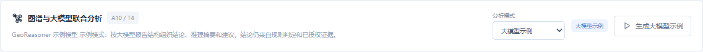
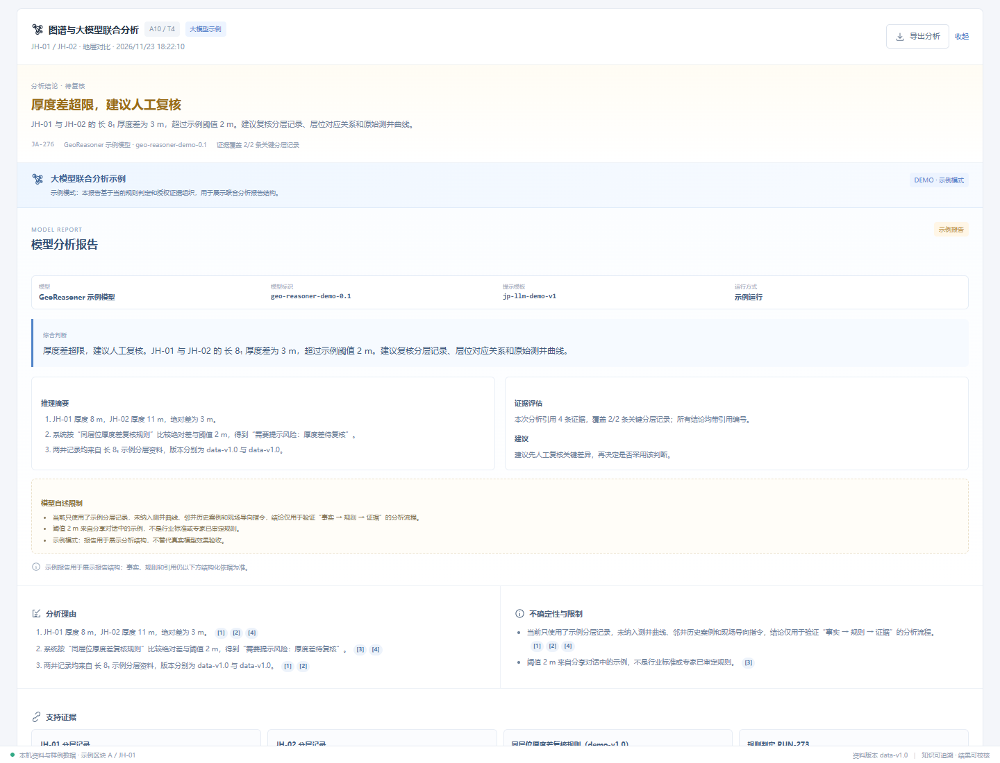
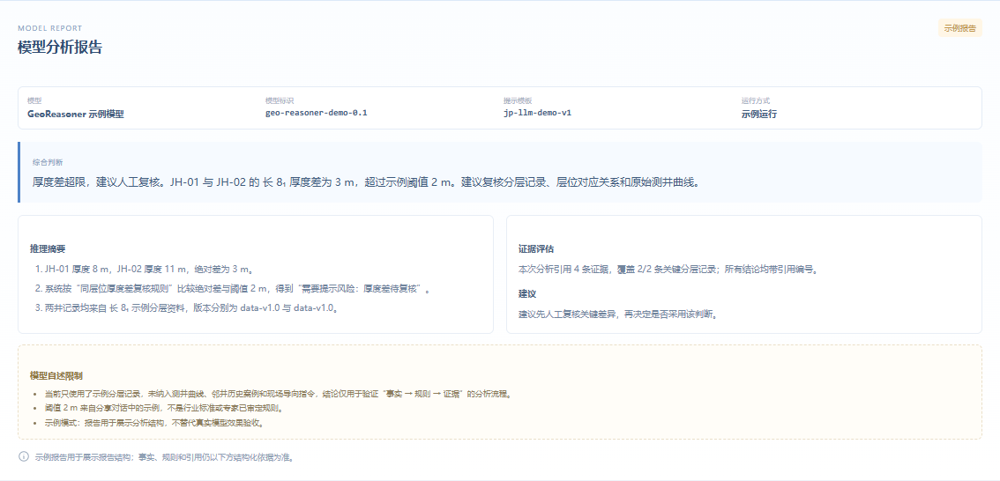

# 09 大模型联合分析示例模式（截图展示版）

版本：0.8.1。示例模式用于展示“图谱事实 + 规则判定 + 证据引用 → 大模型分析报告”的完整结果形态，并保留示例模式标识。

## 目的

真实大模型服务尚未接入。本版本增加一个明确标注的“大模型示例”模式，用于：

- 展示联合分析结果的最终版式；
- 截图展示模型报告、引用、结构化依据和限制声明；
- 为后续接入真实模型保留同一输入包和结果结构；
- 避免把模板结果冒充成真实模型输出。

结果中保留“示例模式”标识，用于区分展示结果与真实模型运行结果。

## 使用方式

1. 在“混合检索”页完成规则判定。
2. 在“图谱与大模型联合分析”面板的“分析模式”中选择：
   - 本地证据归纳
   - 大模型示例
3. 点击“生成大模型示例”。
4. 结果区展示：
   - 分析结论；
   - 大模型示例声明；
   - 模型名称、模型标识、提示模板版本和运行方式；
   - 模型分析报告：综合判断、推理摘要、证据评估、建议、模型自述限制；
   - 下方结构化依据：分析理由、支持／反对证据、引用与原文定位、输入快照。

## 模型报告结构

示例模式复用规则判定和联合分析输入，并在其上生成报告结构：

| 区域 | 内容 |
| --- | --- |
| 综合判断 | 结论标题与摘要的组合表述 |
| 推理摘要 | 由分析理由生成的有序说明 |
| 证据评估 | 证据数量、证据覆盖和引用说明 |
| 建议 | 按结论状态给出参考、复核或补资料建议 |
| 模型自述限制 | 示例数据边界、阈值来源、示例模式说明 |
| 模型元数据 | `GeoReasoner 示例模型`、`geo-reasoner-demo-0.1`、`jp-llm-demo-v1`、本地模拟 |

## 明确不做什么

- 示例模式只展示报告结构和结构化依据。
- 不生成 token 用量、调用耗时、费用或模型置信度等运行指标。
- 不使用真实模型运行结论的标识。
- 保留“示例模式”标识。

## 数据、权限与持久化

- 生成示例分析仍需要当前项目、井、资料、字段和 `run` 权限。
- 示例模式和本地模式使用同一套输入快照、规则版本和证据引用。
- 记录保存 `mode: "demo-llm"`、`analysisMode: "demo-llm"` 和模型元数据。
- 历史记录中的“分析模式”显示为“大模型示例”。
- 支持导出 JSON、回看详情、从历史记录回到检索页打开。
- 离线预览同样支持示例模式。

## 接口

| 方法 | 路径 | 用途 |
| --- | --- | --- |
| POST | `/api/business/joint-run` | 增加可选 `mode: "demo-llm"`；默认 `local`。 |
| GET | `/api/workspace` | 返回 `jointProvider` 与 `demoLlmProvider` 配置信息。 |

## 验证

- `tests/joint.test.mjs` 覆盖地层对比示例模式的报告结构、模型元数据和示例模式声明。
- `tests/neighbor.test.mjs` 覆盖邻井推荐示例模式。
- HTTP 测试覆盖 `mode: "demo-llm"` 的生成与持久化。
- `npm test` 当前应为 **114 项通过、0 失败**。