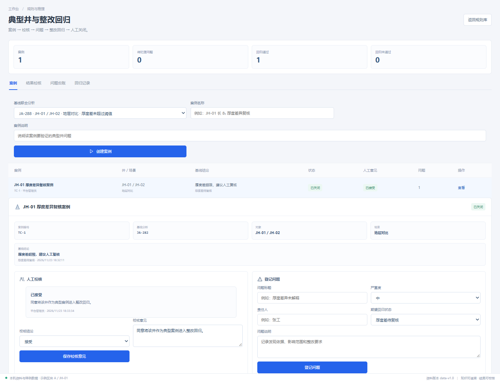
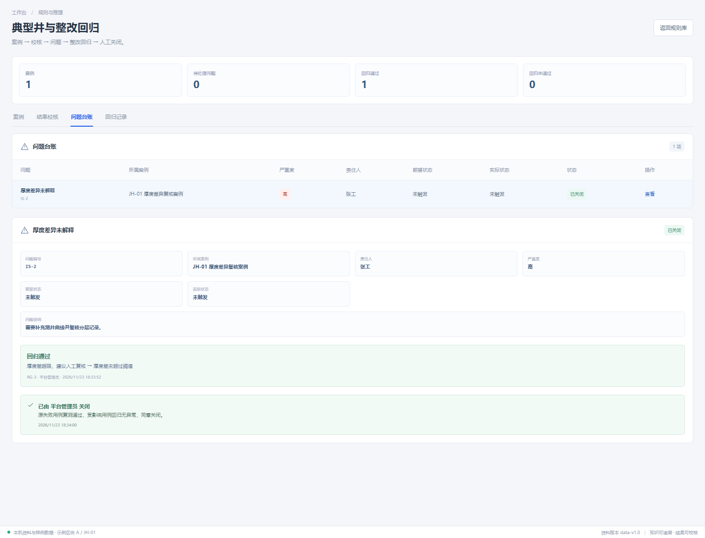
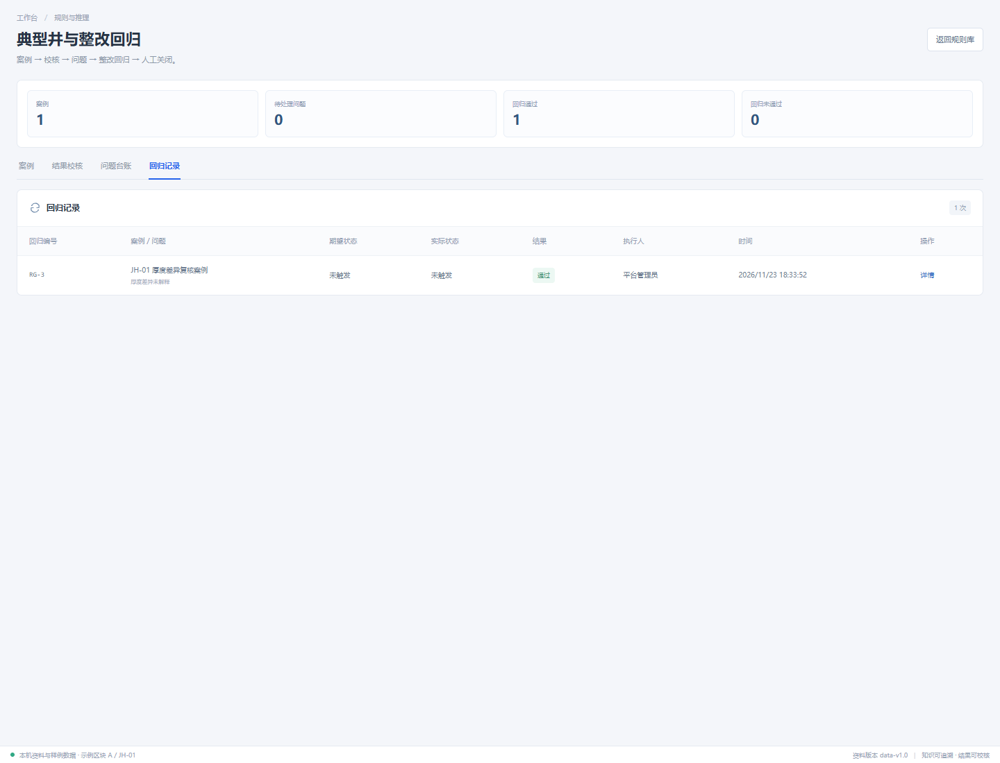

# 10 典型井应用与整改回归（M7-F6）

版本：0.9.0。入口在“规则与推理”页的“典型井与整改回归”卡片，内部使用“案例、结果校核、问题台账、回归记录”四个页签。

## 功能对应

| 编号 | 已实现行为 |
| --- | --- |
| M7-F6 | 从已完成的联合分析建立典型案例，保存专家意见，登记问题，记录整改分析版本，复跑原失败用例和受影响用例，对比前后结果，并由专家人工关闭。 |
| T6 | 案例保留基线结论、问题发现依据、整改版本、回归结果和人工关闭意见；回归未通过时问题保持待整改。 |
| M6-F4 | 案例、问题、回归记录按项目、井、字段、分析和校核权限过滤；撤销证据权限后案例不可见。 |

## 使用流程

1. 先在“混合检索”完成一次规则判定和联合分析，作为案例基线。
2. 在“规则与推理”页点击“进入整改回归”。
3. **案例**页签选择基线联合分析，填写案例名称和说明，创建案例。
4. **结果校核**页签由有 `review` 权限的专家填写接受、修改后接受或驳回意见。
5. **问题台账**页签登记问题：标题、说明、严重度、责任人和期望回归状态。
6. 在问题详情中选择整改后的同场景联合分析，填写整改说明和受影响用例，运行整改回归。
7. 回归通过后问题进入“待关闭”；专家填写关闭意见后关闭问题。
8. 所有问题关闭后，案例状态变为“已关闭”。

## 页面结构

### 案例

- 基线分析选择：展示分析编号、井、场景和结论。
- 案例列表：名称、井/场景、基线结论、状态、人工意见、问题数。
- 案例详情：基线快照、人工校核、问题登记和问题台账。

### 结果校核

- 列出项目内典型案例，优先显示待校核案例。
- 保存接受、修改后接受或驳回意见；驳回或修改必须填写理由。
- 校核人、时间和意见一并保存。

### 问题台账

- 展示问题、所属案例、严重度、责任人、期望状态、实际状态和处理状态。
- 问题状态：`待整改` → `待关闭` → `已关闭`。
- 回归未通过时保持 `待整改`，不能直接关闭。

### 回归记录

- 保存基线分析、整改分析、期望状态、实际状态、回归结果、受影响用例、执行人和时间。
- 点击“详情”可查看基线与整改后的结论、整改说明和受影响案例。

## 状态与判定

- 案例：`待校核`、`已校核`、`已驳回`、`整改中`、`已关闭`。
- 问题：`待整改`、`待关闭`、`已关闭`。
- 回归通过条件：整改后联合分析的实际状态等于问题登记的期望状态。
- 回归未通过：问题保持待整改，允许重新选择整改分析并再次回归。
- 关闭条件：问题必须处于待关闭且填写人工关闭意见。

## 权限与数据边界

- 查看整改回归页需要 `reasoning` 权限。
- 创建案例、登记问题、运行回归需要 `run` 权限。
- 校核案例、关闭问题需要 `review` 权限。
- 案例基线分析必须仍对当前用户可见；分析权限或字段授权撤销后，案例及相关问题、回归记录不再返回。
- 案例、问题、回归记录保存到 `.runtime/platform.json` 的 `regression` 对象。
- 离线预览使用同一业务模型，数据保存在浏览器存储中。

## 接口

| 方法 | 路径 | 用途 |
| --- | --- | --- |
| GET | `/api/regression?projectId=p1` | 返回案例、问题、回归记录、可选分析和当前能力。 |
| POST | `/api/regression/mutate` | `action` 为 `create-case`、`review-case`、`create-issue`、`fix-issue`、`close-issue`。 |

## 验证

`npm test` 当前共 114 项通过。`tests/regression.test.mjs` 覆盖：

- 案例创建、专家校核、问题登记、回归通过和人工关闭；
- 回归状态与期望不一致时保持待整改，不能直接关闭；
- 项目、井、字段和校核权限，撤权后案例不可见；
- HTTP 案例、校核、问题、回归和关闭闭环。