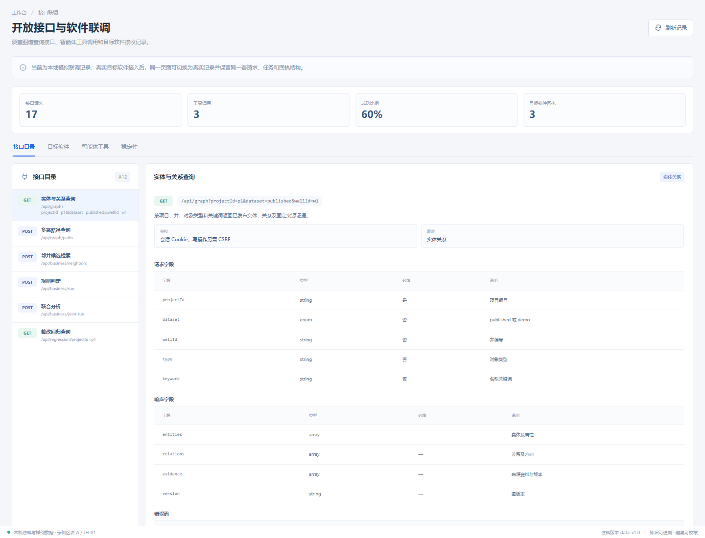
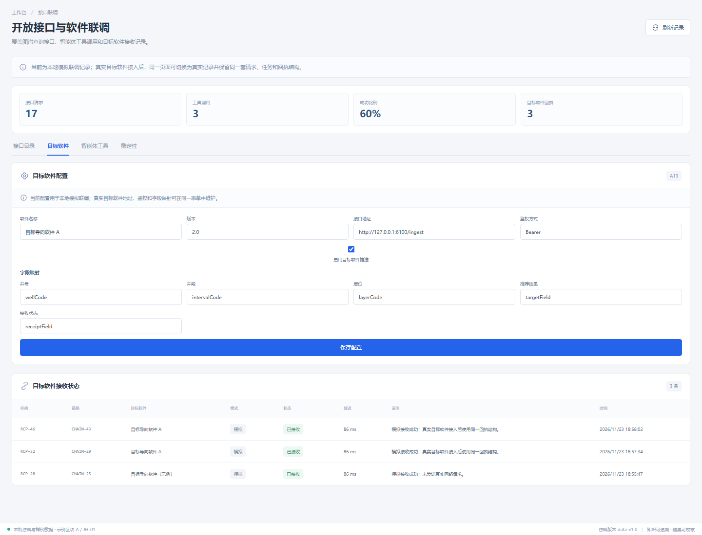
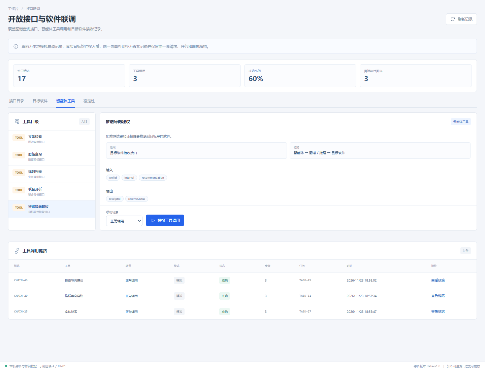
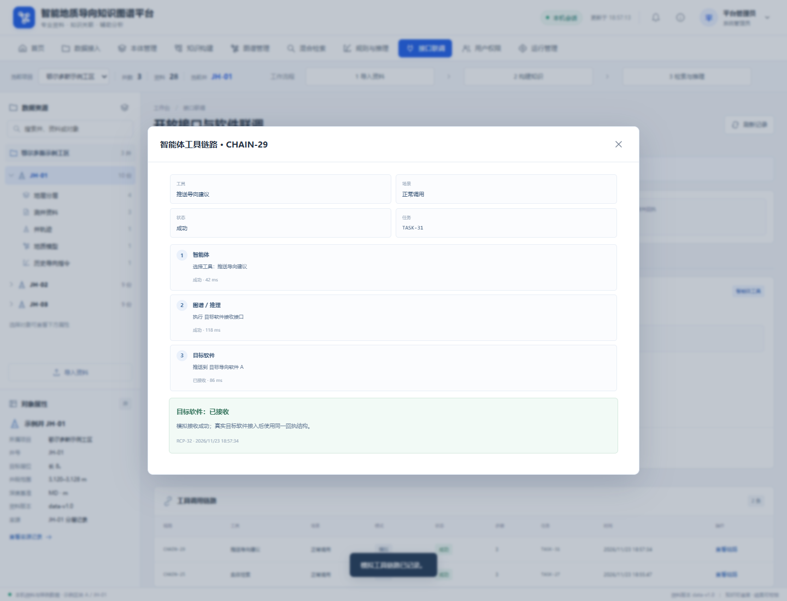
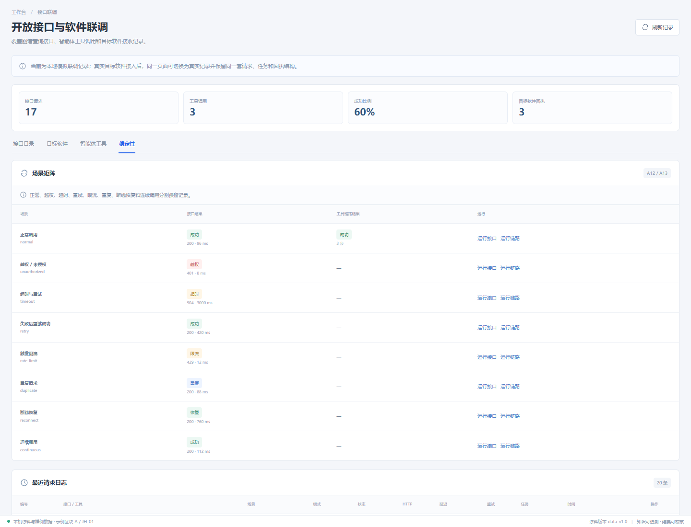

# 11 开放接口与软件联调（M12）

版本：0.10.0。入口为顶部“接口联调”，页面分为“图谱接口 A12”和“智能体／目标软件 A13”两组，共用接口文档、请求详情和联调记录组件。

## 功能对应

| 编号 | 已实现行为 |
| --- | --- |
| M12-F1 | 接口目录、字段、鉴权、错误码、请求／响应示例和任务编号；覆盖实体关系、检索、规则判定、联合分析和整改回归。 |
| M12-F3 | 目标软件配置、井／井段／层位／推荐结果／接收状态映射，以及目标软件接收回执。 |
| M12-F6 | 智能体工具目录、工具调用记录和“智能体 → 图谱／推理 → 目标软件”链路详情。 |
| M12-F5 | 正常、越权、超时、重试、限流、重复请求、断线恢复和连续调用分别保留状态、延迟、重试、任务和日志。 |

## 页面结构

### 接口目录

- 左侧接口列表，标注 GET / POST。
- 右侧展示接口路径、鉴权方式、覆盖范围、请求字段、响应字段、错误码和示例。
- 选择联调场景后发送模拟请求，生成请求编号、HTTP 状态、延迟、重试次数和任务编号。
- 请求详情可查看请求体和响应体。

### 目标软件

- 维护软件名称、版本、接口地址、鉴权方式和启停状态。
- 配置井号、井段、层位、推荐结果和接收状态字段映射。
- 展示目标软件接收回执、模式、状态、延迟、说明和时间。

### 智能体工具

- 工具目录包括实体检索、路径查询、规则判定、联合分析和推送导向建议。
- 选择工具和联调场景后生成调用链路。
- 链路详情展示智能体、图谱／推理、目标软件三个环节的状态和延迟。
- 推送类工具生成目标软件接收回执；纯查询工具不生成目标回执。

### 稳定性

- 场景矩阵覆盖正常、越权、超时、限流、重复、断线恢复和连续调用。
- 每个场景可分别运行接口请求或智能体工具链路。
- 记录 HTTP 状态、延迟、重试、任务编号和最近请求日志。

## 模拟与真实记录

- 当前目标软件未接入真实外部服务，页面中的请求、工具链路和回执均标记模式为“模拟”。
- 真实软件接入后，沿用同一请求、任务和回执结构，将记录模式改为“真实”。
- 模拟记录不会被标记为真实联调记录。

## 权限与数据边界

- 查看接口联调页面和提交模拟请求需要 `integration` 权限。
- 记录按项目保存到 `.runtime/platform.json` 的 `integration` 对象。
- 模拟请求不发起外部网络调用；目标是先固定接口字段、错误码、日志和回执结构。
- 离线预览使用同一业务模型，数据保存在浏览器存储中。

## 接口

| 方法 | 路径 | 用途 |
| --- | --- | --- |
| GET | `/api/integration?projectId=p1` | 返回接口目录、工具目录、配置、请求、链路和回执。 |
| POST | `/api/integration/mutate` | `action` 为 `send`、`tool-call` 或 `config`。 |

## 验证

`npm test` 当前共 114 项通过。`tests/integration.test.mjs` 覆盖：

- 接口目录对实体关系、检索和推理的覆盖；
- 正常、越权、超时、限流、重复、恢复和连续调用；
- 智能体工具链路和目标软件回执；
- 目标软件配置和字段映射；
- 接口联调权限；
- HTTP 接口目录、请求、工具链路和配置闭环。