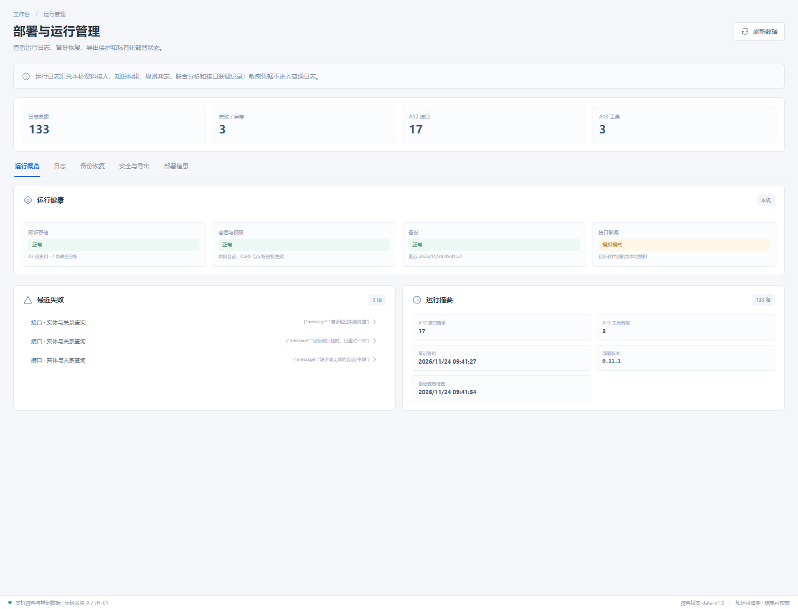
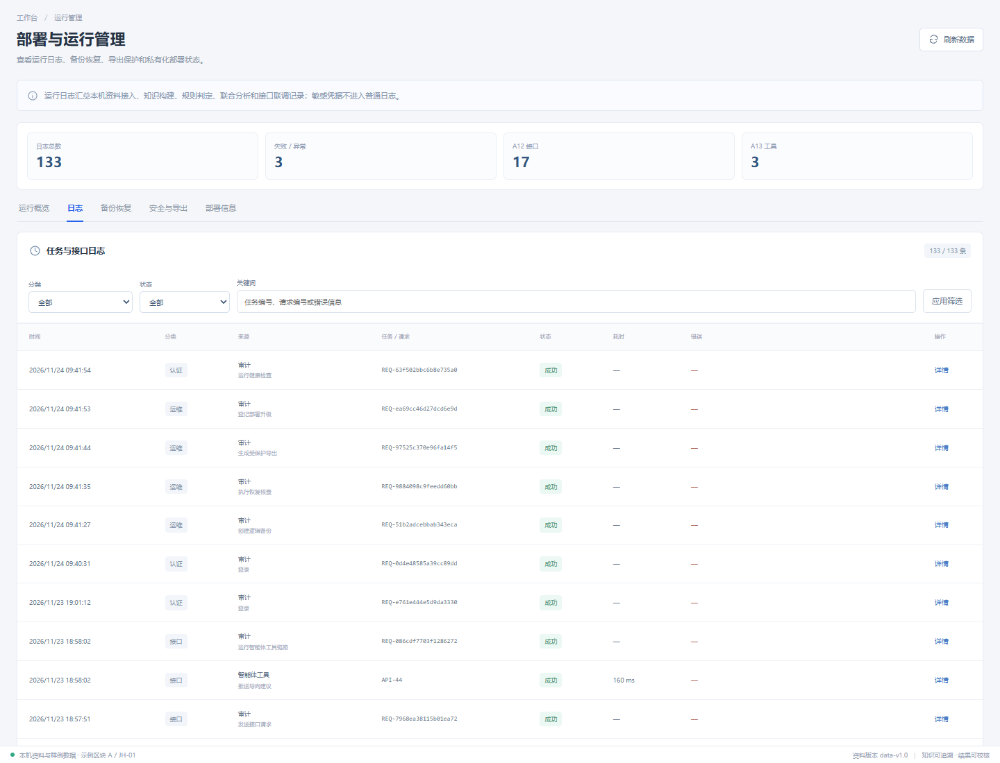
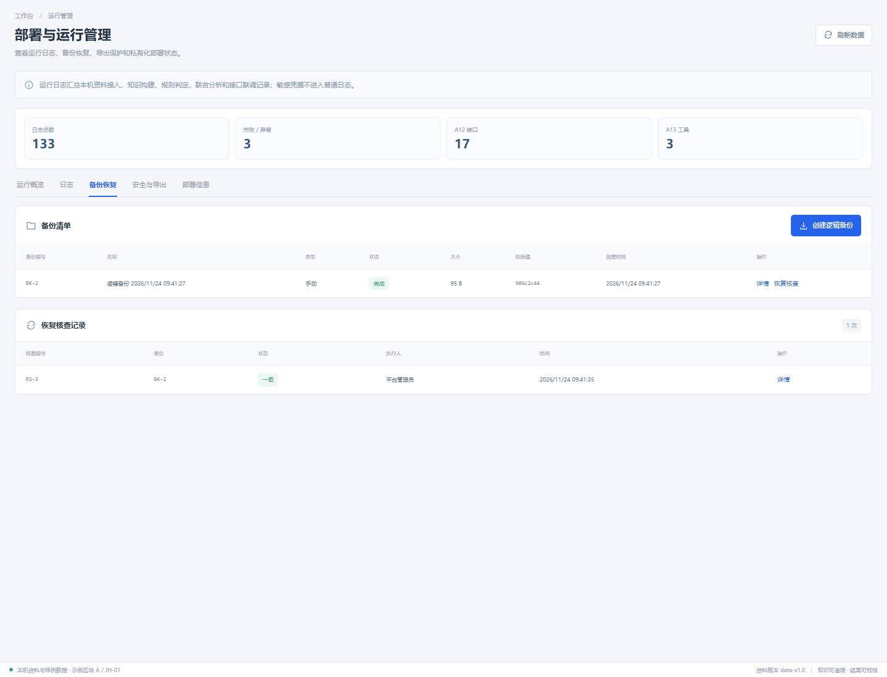
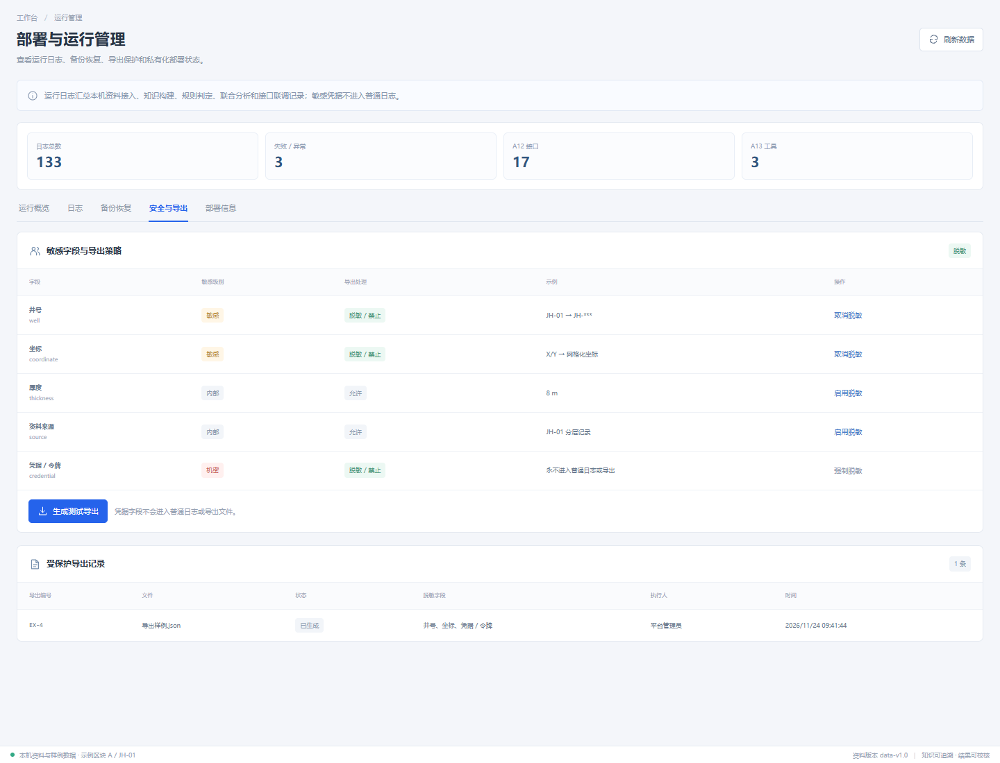
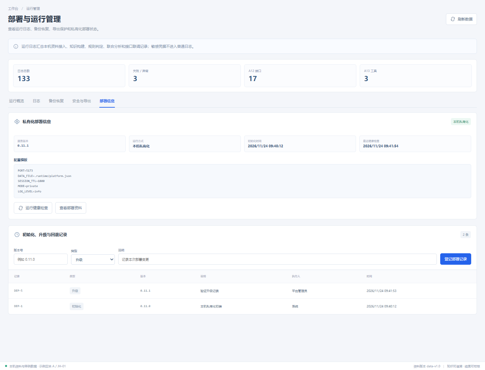

# 12 部署与运行管理（M13）

版本：0.11.0。入口为顶部“运行管理”，包含运行概览、日志、备份恢复、安全与导出、部署信息五个页签。

## 功能对应

| 编号 | 已实现行为 |
| --- | --- |
| M13-F1 | 汇总资料接入、知识构建、规则判定、联合分析和接口联调日志；按分类、状态和关键词筛选，展示状态、耗时、错误、请求编号和任务编号，并统计 A12 接口与 A13 工具调用。 |
| M13-F2 | 创建逻辑备份、查看校验值与对象数量、执行恢复一致性核查，保存核查记录。 |
| M13-F3 | 维护敏感字段与导出策略，展示受保护字段和导出记录；凭据字段强制脱敏，不进入普通日志或导出。 |
| M13-F4 | 展示服务版本、运行方式、健康状态、配置模板、初始化／升级／回退记录及部署资料入口。 |

## 页面结构

### 运行概览

- 日志总数、失败／异常、A12 接口和 A13 工具调用统计。
- 知识存储、会话权限、备份和接口联调健康卡片。
- 最近失败任务和运行摘要。
- 可直接点击失败项查看日志详情。

### 日志

- 分类：导入、抽取、检索、推理、接口、运维、认证。
- 状态：成功、失败、运行中、超时、限流、越权。
- 支持任务编号、请求编号和错误信息关键词筛选。
- 日志详情展示来源、状态、耗时、请求编号、任务编号、错误和说明。

### 备份恢复

- 创建逻辑备份，保存对象数量、校验值、大小和一致性检查。
- 恢复核查比较备份时与当前项目、井、资料、规则运行、联合分析、整改案例和接口请求数量。
- 核查结果标记“一致”或“存在差异”。
- 当前为逻辑一致性核查，不直接覆盖原始文件；实际文件回滚由部署环境执行。

### 安全与导出

- 字段策略包括井号、坐标、厚度、资料来源和凭据／令牌。
- 可对普通敏感字段启用或取消脱敏。
- 凭据字段强制脱敏，不允许取消。
- 测试导出记录保存文件、状态、脱敏字段、执行人和时间。
- 凭据不进入普通日志和导出内容。

### 部署信息

- 服务版本、运行方式、初始化时间和最近健康检查。
- 配置模板展示端口、数据文件、会话有效期、运行模式和日志级别。
- 初始化、升级、回退记录保存版本、说明、执行人和时间。
- 提供健康检查和部署资料入口。

## 权限与数据边界

- 查看和操作运行管理需要 `operations` 权限。
- 日志由现有资料接入、知识构建、规则判定、联合分析、接口联调和审计记录汇总，不重复写入业务事实。
- 备份为逻辑快照记录，包含对象数量和校验值；恢复核查不会直接覆盖原始运行文件。
- 敏感字段策略保存在 `.runtime/platform.json` 的 `operations` 对象。
- 离线预览使用同一业务模型，数据保存在浏览器存储中。

## 接口

| 方法 | 路径 | 用途 |
| --- | --- | --- |
| GET | `/api/operations?projectId=p1` | 返回日志、备份、恢复核查、导出策略、导出记录和部署信息。 |
| POST | `/api/operations/mutate` | `action` 为 `backup`、`restore`、`toggle-policy`、`test-export`、`deploy-record` 或 `health-check`。 |

## 验证

`npm test` 当前共 114 项通过。`tests/operations.test.mjs` 覆盖：

- 运行日志对导入、抽取、检索、推理和接口的汇总；
- 逻辑备份、恢复一致性与差异核查；
- 导出策略、凭据强制脱敏和导出记录；
- 升级、回退、健康检查和运行管理权限；
- HTTP 日志、备份、恢复、导出和部署闭环。