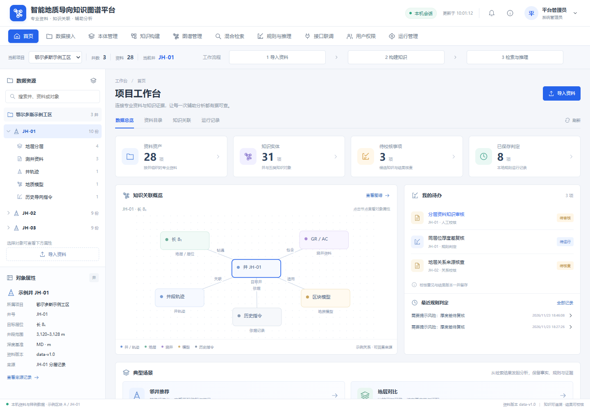
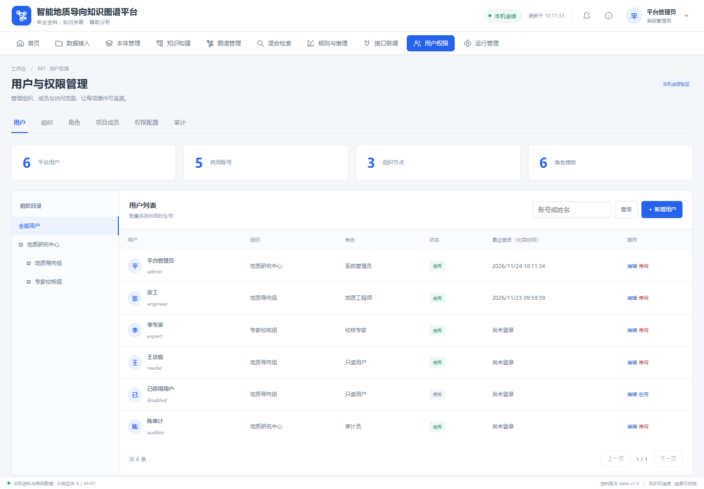
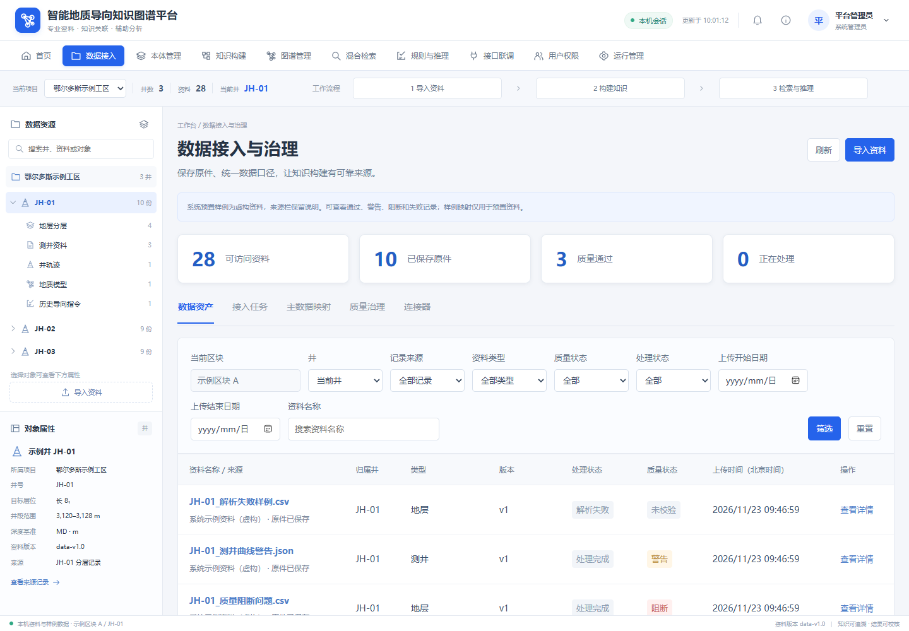
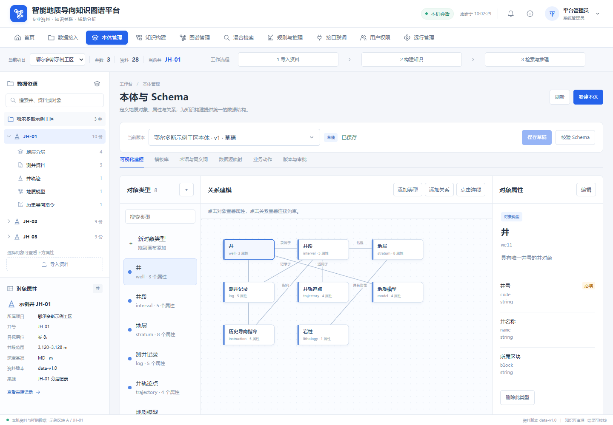
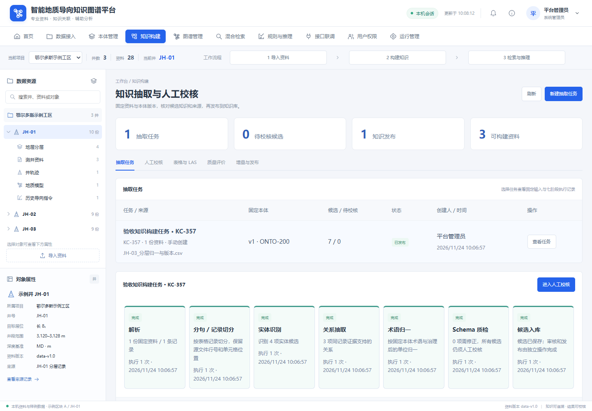
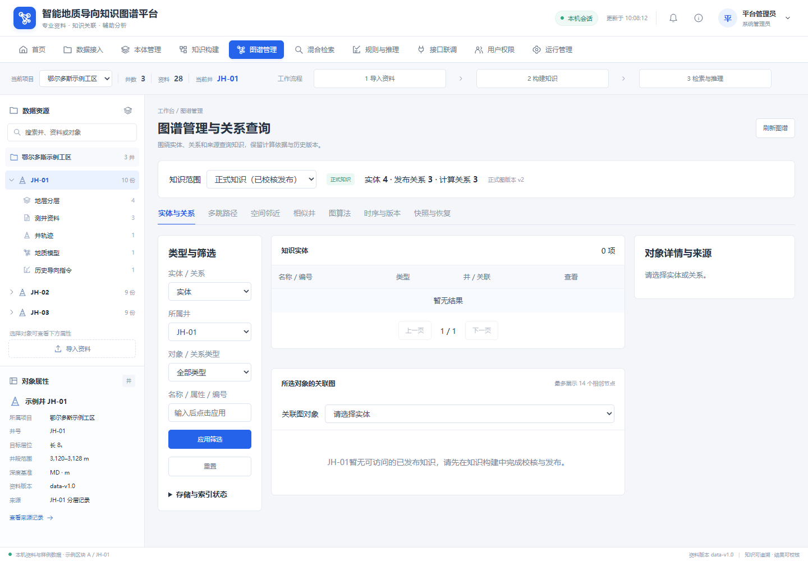
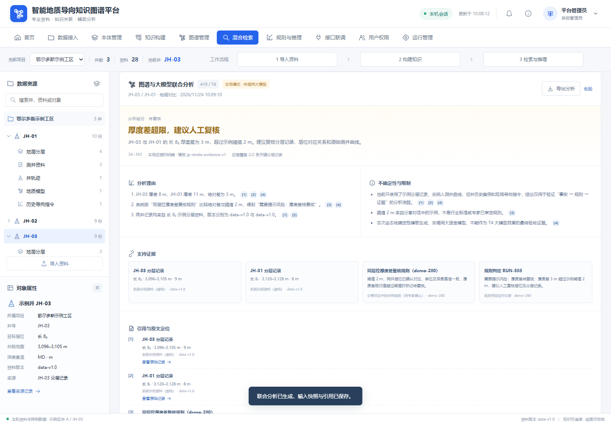
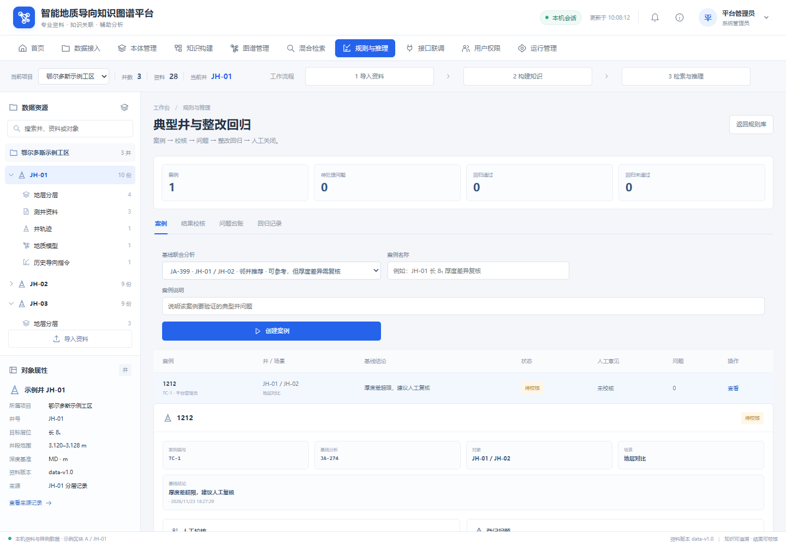

# 智能地质导向知识图谱平台 · 全流程验收报告

- 验收日期：2026-11-24
- 平台版本：0.11.0
- 验收环境：Windows 本机服务 `http://127.0.0.1:5173`
- 数据环境：内置示例项目与示例井，资料、规则、接口和目标软件均为示例配置
- 验收依据：`docs/页面搭建步骤.html` 的 12 个页面搭建步骤、六项测试 T1～T6、A01～A16 验收项

## 一、验收结论

**示例环境全流程验收通过。**

12 个页面搭建步骤均可进入并完成对应业务操作；登录权限、资料治理、本体发布、知识构建、图谱查询、检索推理、邻井推荐、人工校核、整改回归、接口联调、运行管理和离线预览均通过本次走查。

自动化测试结果：**114 项通过，0 失败**。

真实目标软件、真实大模型服务、外部图数据库和生产部署尚未接入，属于后续生产接入范围，不影响本次示例环境验收结论。

## 二、验收账号与权限

| 账号 | 角色 | 验收结果 |
| --- | --- | --- |
| admin | 系统管理员 | 可访问全部模块，可审批、发布、审核和运行管理 |
| reader | 只读用户 | 只显示首页、数据接入、图谱管理、混合检索；仅可见授权井，深度等受限字段不返回；直接访问运行管理显示“无权限访问” |
| engineer / expert / auditor | 工程师／校核专家／审计员 | 角色权限由自动化测试覆盖组织、成员、授权和审计边界 |





## 三、12 个步骤验收结果

| 步骤 | 验收内容 | 关键证据 | 结果 |
| --- | --- | --- | --- |
| 1 | 登录、用户、组织、角色与项目授权 | admin 登录成功；reader 菜单和字段受限；直接越权访问被拒绝 | 通过 |
| 2 | 数据接入与治理 | 28 份可访问资料、10 份已保存原件；通过、警告、阻断、解析失败样例均可查看 | 通过 |
| 3 | 本体与 Schema 管理 | ONTO-200 从草稿送审、批准并发布，版本 revision 4 | 通过 |
| 4 | 知识抽取与人工校核 | KC-357 从 BUILD-103 创建，七阶段执行完成，7 个候选全部校核接受 | 通过 |
| 5 | 知识发布与图谱管理 | PUB-376 发布 4 个实体、3 条关系；正式图显示 4 节点、6 条边（含 3 条计算关系） | 通过 |
| 6 | 检索、规则关联与推理 | RUN-388 触发厚度差规则；JA-391 生成联合分析，引用和输入快照完整 | 通过 |
| 7 | 邻井推荐与专家校核 | JH-02 作为同层位候选，距离 1.6 km、厚度差 3 m；JA-399 联合分析生成并登记接受意见 | 通过 |
| 8 | 典型井整改回归 | TC-1 完成人工校核；IS-2 登记问题；RG-3 回归通过；问题与案例均关闭 | 通过 |
| 9 | 开放接口与软件联调 | A12 接口请求、A13 智能体工具链路、目标软件回执和稳定性场景均可运行 | 通过（模拟联调） |
| 10 | 备份恢复与安全导出 | 逻辑备份、恢复一致性核查、脱敏策略、测试导出和凭据强制保护均可用 | 通过（逻辑备份） |
| 11 | 私有化部署信息 | 版本、健康状态、配置模板、初始化／升级／回退记录和部署资料入口均可见 | 通过 |
| 12 | 离线预览 | 离线登录、运行管理 5 个页签、39 条日志可读取 | 通过 |













## 四、关键流程证据

### 1. 本体发布

- 版本：`ONTO-200`
- 流程：草稿 → 送审 → 批准 → 发布
- 发布 revision：4
- 发布前需要影响确认，符合设计中的审批门槛。

### 2. 知识构建与发布

- 固定资料：`VER-97` / `BUILD-103`（JH-03 分层归一与版本）
- 构建任务：`KC-357`
- 候选：7 个，全部人工接受
- 发布记录：`PUB-376`
- 发布结果：4 个实体、3 条关系
- 索引与缓存：本机名称索引重建、统计缓存刷新

### 3. 图谱查询

- 正式图：4 个节点、6 条边
- 发布关系：3 条
- 计算关系：3 条
- 多跳路径查询：起点到终点返回 4 条路径，未达到搜索上限

### 4. 检索与推理

- 规则运行：`RUN-388`
- 规则结论：厚度差待复核
- 联合分析：`JA-391`
- 结论：厚度差超限，建议人工复核
- 引用、证据覆盖、输入快照和规则版本均保留

### 5. 邻井推荐

- 候选井：JH-02
- 层位：长 8₁，同层位
- 距离：1.6 km
- 厚度差：3 m
- 联合分析：`JA-399`
- 人工意见：已接受

### 6. 整改回归

- 案例：`TC-1`
- 问题：`IS-2`
- 基线结论：厚度差超限，建议人工复核
- 整改后结论：厚度差未超过阈值
- 回归记录：`RG-3`，通过
- 问题状态：已关闭
- 案例状态：已关闭

### 7. 接口联调

- A12 接口请求与 A13 工具调用分别统计
- 正常、越权、超时、重试、限流、重复、断线恢复和连续调用均有记录
- 智能体工具链路包含智能体、图谱／推理、目标软件三个环节
- 目标软件回执包含接收状态和延迟

### 8. 运行管理

- 运行日志覆盖导入、抽取、检索、推理、接口、运维和认证
- 备份清单和恢复核查记录可查看
- 敏感字段策略可切换，凭据字段强制脱敏
- 部署信息可登记升级、回退和健康检查

## 五、本次验收发现

### 已处理

1. **运行日志分类修正**
   整改、回归类审计日志原先可能落入“认证”分类；本次验收中已调整为“推理”。目标软件配置归入“接口”，健康检查归入“运维”。

### 非阻塞提示

1. **跨层位样例选择**
   当目标井选择 JH-03（长 8₂）而参考井回退为 JH-01（长 8₁）时，规则面板仍允许使用“已确认同层位”的示例输入。页面已注明使用示例资料，但建议正式使用时优先选择同层位参考井，或增加层位不一致警告。

2. **图谱当前井无发布知识**
   当前井为 JH-01 时，正式图显示该井暂无已发布知识；切换到 JH-03 后可看到本次发布的 4 个实体。属于权限和发布范围提示，不是数据丢失。

3. **生产接入项**
   目标软件为模拟联调，大模型为示例模式，备份为逻辑快照与一致性核查，外部图数据库、向量库和生产部署尚未接入。上述内容应在生产验收阶段单独核查。

## 六、自动化验证

执行：

```powershell
npm test
```

结果：**114 项通过，0 失败**。

覆盖范围包括登录权限、数据治理、本体审批发布、知识抽取与校核、图谱查询与快照、检索与规则、联合分析、邻井推荐、整改回归、接口联调、运行管理、HTTP 持久化和离线预览。

## 七、验收意见

- 示例环境全流程：**通过**
- 页面与功能入口完整性：**通过**
- 权限与审计边界：**通过**
- 自动化回归：**通过**
- 生产外部服务接入：**待后续验收**

建议进入交付前最后检查：确认示例数据标识、目标软件真实地址和大模型服务接入计划，然后进行生产环境专项验收。